> **Copy for the name swiper PWA.** This is the Nest app's E16 spec, copied from `kirilreznik/pregnancy-manager` (`docs/prd/migration/16-name-swipe.md`, main @ 794d063) on 2026-11-04 so the PWA run has it without the other repo. It is the source of truth for the card, deck, lists, duel and data rules. Where it talks about React Native, Expo, `@/theme`, AsyncStorage, the More tab or the Today screen, read [`tasks/prd-names-pwa.md`](../../tasks/prd-names-pwa.md) §7 for the web equivalent. Relative links to the app repo (epic, Ralph run) don't resolve here.

# E16 — Name swipe ("בחירת שם")

| | |
|---|---|
| **Epic** | [00-EPIC](./00-EPIC.md) |
| **Depends on** | E01 (data layer), E08 (space members, sharing) |
| **Status** | New · added to store v1 by the owner on 2026-10-31 |
| **Scope** | The whole feature, with a **sample deck of 10 names** that have full card content (§2). Content for all names is a follow-up, E16b (§8). |
| **PWA sources** | None. This is a new feature with no PWA equivalent. |
| **Brainstorm** | [Name swipe feature: brainstorm](https://claude.ai/artifact/GScSTTTZKBHhMPcDXTJWDQ) |
| **Design** | [Nest name swipe](https://claude.ai/artifact/XoQRXdTxw2i2ZTN7XVwjJJ) (Claude Design canvas, Nest brand; boards 1–11). Images and sources in the repo: [§ Design](#design) |
| **Ralph run** | [`tasks/prd-name-swipe.md`](../../../tasks/prd-name-swipe.md) (a verification story, 48 build stories, then up to 3 QA → fix cycles) · stories in [`scripts/ralph/prd-name-swipe.json`](../../../scripts/ralph/prd-name-swipe.json) · run with `scripts/ralph/run-name-swipe.sh` |

## 1. Context

People spend weeks going back and forth on a baby's name. Nest turns it into a light, private game: one name card at a time, with how many babies in Israel got that name, whether it's rising or fading, a one-line intro, a Bible reference when there is one, and well-known people with the same name. Each person keeps or skips names. When two people manage the pregnancy together, a name they both kept becomes a match. Nobody ever sees the names the other person skipped.

It must work just as well for someone on their own (single parents are a core audience), so the solo path is a full feature, not a fallback: a shortlist and a head-to-head round to narrow it down.

Owner decisions (2026-10-31, plus 2026-11-03 for card content):

1. Include names from every community in the CBS data (Jewish, Muslim, Christian-Arab, Druze), with an optional filter by origin. Don't decide for the user.
2. Ship before launch, as part of store v1.
3. Intros are generated by Claude. The owner spot-checks a random sample instead of reviewing every entry (applies to E16b).
4. Cards also show a Bible reference when there is one and up to 2 well-known people with the name. People come from Wikidata, never from AI, and exclude politicians and controversial figures.
5. (2026-11-03) E16 builds the feature with 10 sample names only. The full list, with all descriptions, is populated and reviewed later in E16b.

## 2. Data

### Names and counts (`assets/data/names.json`)

- Built by `node scripts/build-names.mjs` from the CBS release 391/2025 (newborn names 1949–2024), via the CC0 package [babynamesIL](https://github.com/aviezerl/babynamesIL) pinned to one commit. Regenerate once a year when CBS publishes a new release.
- 19,884 names. Per name: all-time births by sex (`m`, `f`, including years under the 5-baby publishing threshold), sectors (`s`), and births per year 2000–2024 (`y`, present for 3,478 names). About 1 MB raw, about 190 KB gzipped. Bundled with the app, so it works offline.
- These are **births, not living people**. Copy always says births: "ניתן ל־1,189 תינוקות ב־2024", "ניתן לכ־55,000 תינוקות מאז 1949".
- **Licence:** CBS open licence, commercial use allowed. Attribution is required: the "על הנתונים" sheet (FR-14) names CBS, the file, the access date and links to the data and to the licence. Never suggest that CBS endorses Nest.

### Sample content (`assets/data/name-content.json`, 10 names)

E16 ships with a small, hand-written content file so every card in the build is complete. The owner reviews all 10 entries before release, and each person listed is checked against Wikidata.

```json
{ "names": { "יעל": {
    "niqqud": "יָעֵל",
    "intro": "יעל היא עז הבר שחיה במצוקים, גם בעין גדי.",
    "bible": { "text": "יעל אשת חבר הקיני, מגיבורות שירת דבורה.", "ref": "שופטים ד–ה" },
    "people": [{ "name": "יעל ארד", "what": "זכתה במדליה האולימפית הראשונה של ישראל, ג׳ודו 1992" }]
} } }
```

The 10 names were chosen to cover every state the card can be in:

| Name | Covers |
|---|---|
| זיו | unisex (71% boys), medium popularity, steady |
| נועם | unisex (77% boys), common, 2 known people |
| יעל | girls (over 99%), steady |
| לביא | boys (over 99%), rising fast, no known people |
| תמר | girls, a Bible figure instead of a quote |
| שקד | unisex (31% boys), medium, a Bible word, no people |
| אריאל | unisex (77% boys), the 2nd most common name in 2024 |
| אביגיל | girls (100%), rose strongly since 2000 |
| עמית | unisex (67% boys), falling |
| אלה | girls, a Bible place name |

- **Deck in E16:** only these 10 names, with counts and trends read from `names.json`. Filters (FR-10) work on them, and a filter with no matches shows "אין שמות שמתאימים לסינון הזה" with "איפוס סינון". When all 10 are decided, the deck shows "עברת על כל השמות. בקרוב יתווספו עוד." with a link to "השמות שלי".
- **Code is ready for the full list:** the deck reads every name that has a content entry, so E16b only replaces the JSON file. No screen changes are needed.
- **Intro rules (same in E16b):** one short, neutral line on the origin and literal meaning. No claims about luck, character or destiny, no religious judgement, the same tone for every origin.

### Derived values (`src/domain/names/`, pure and tested)

- **Sex tag:** `בן` when 90% or more of births are boys, `בת` when 90% or more are girls, otherwise `מתאים לכולם` (applies only to names with 200 or more births, so tiny counts don't create false unisex tags; smaller names use the majority sex).
- **Popularity band:** by births in the latest year with data: `נפוץ` (top 100), `בינוני` (101–500), `נדיר` (the rest and names with no recent year).
- **Trend:** compare the average of the last 3 years with the 3 years five years earlier: `בעלייה` (+25% or more), `בירידה` (−25% or more), otherwise `יציב`. Names with too little data show no trend.

## Design

The design was reviewed with the owner on 2026-11-03 and is the reference for this PRD. Where a board and an FR differ, the FR wins.

**Artifacts**

| What | Link |
|---|---|
| Design canvas (11 boards, boards 2, 6, 8 to 11 are clickable) | [Nest name swipe](https://claude.ai/artifact/XoQRXdTxw2i2ZTN7XVwjJJ) |
| Brand and tokens | [Nest brand design system](https://claude.ai/artifact/Vr8SvoGseHSMLFYySjr67D) (`@/theme`) |
| Feature brainstorm (data, licence, UX options) | [Name swipe feature: brainstorm](https://claude.ai/artifact/GScSTTTZKBHhMPcDXTJWDQ) |
| Screen images (PNG, 390 × 844 @2x) | [`16-name-swipe-design/screens/`](./design/screens/) |
| Board sources (HTML, exact sizes, colors and copy) | [`16-name-swipe-design/source/`](./design/source/) |
| Background photos that ship | `assets/images/names/fabric.jpg`, `notebook.jpg`, `nursery.jpg` |

**Boards**

| # | Screen | Covers |
|---|---|---|
| 1 | פתיחה | FR-3, FR-4 |
| 2 | כרטיס שם, ללא רקע | FR-5 to FR-8, FR-8b |
| 3 | סינון | FR-10, FR-11 |
| 4 | יש התאמה | FR-13 (match banner) |
| 5 | השמות שלי | FR-12, FR-13 |
| 6 | דו־קרב | FR-13 (head-to-head) |
| 7 | על הנתונים | FR-14 |
| 8 | כרטיס על תמונה · בדים (default) | Look, FR-5a, FR-5b, FR-8d |
| 9 | כרטיס על תמונה · מחברת | Look, FR-8d |
| 10 | כרטיס על תמונה · חדר תינוק | Look, FR-8d |
| 11 | רקע למסך | FR-8a to FR-8e |

Names, surnames and numbers on the boards are examples. Counts and trends for זיו come from the real CBS data; the surname "לוי" and the list contents are fictional.

| 1 · פתיחה | 2 · כרטיס שם | 3 · סינון | 4 · יש התאמה |
|---|---|---|---|
| 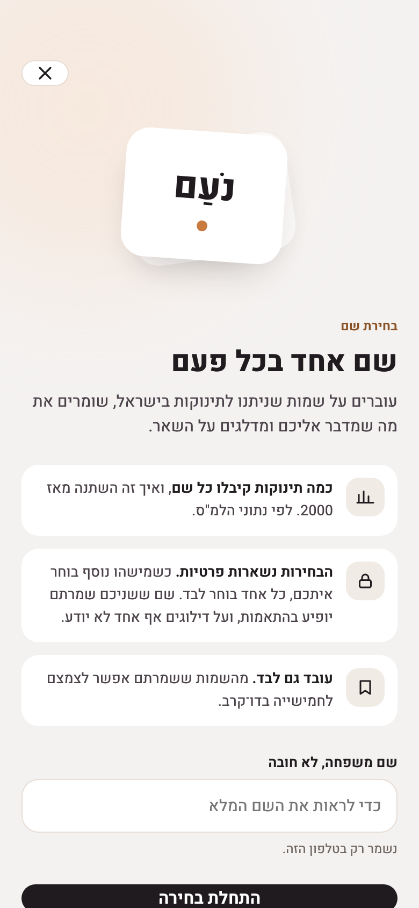 | 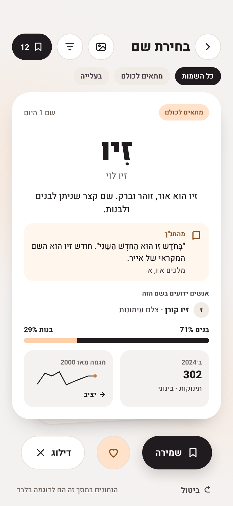 | 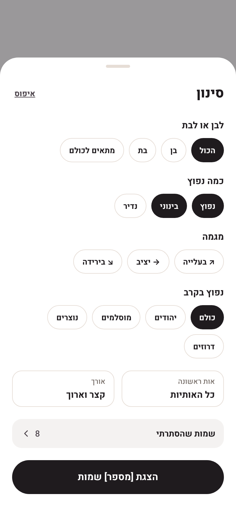 | 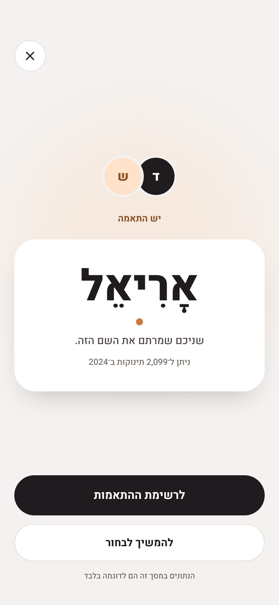 |

| 5 · השמות שלי | 6 · דו־קרב | 7 · על הנתונים | 11 · רקע למסך |
|---|---|---|---|
| 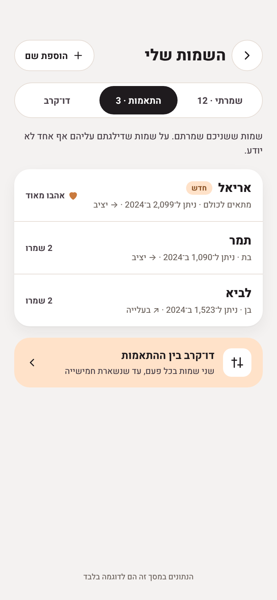 | 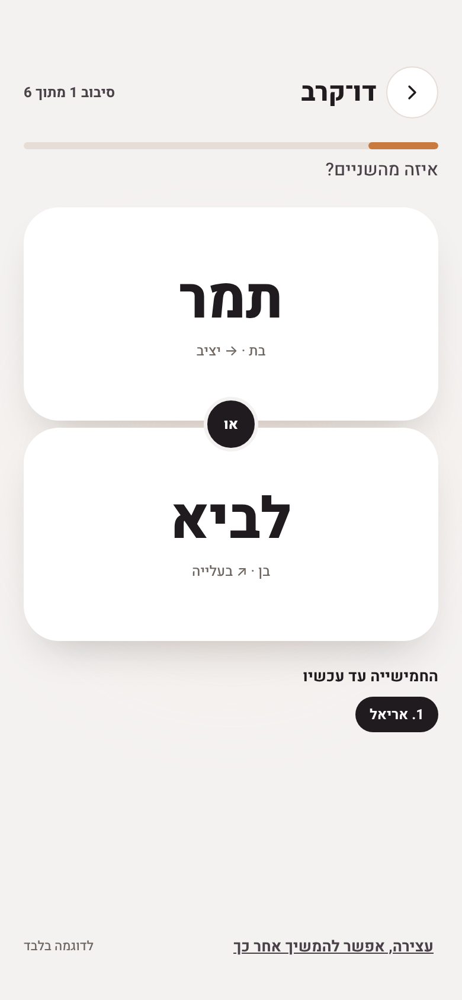 | 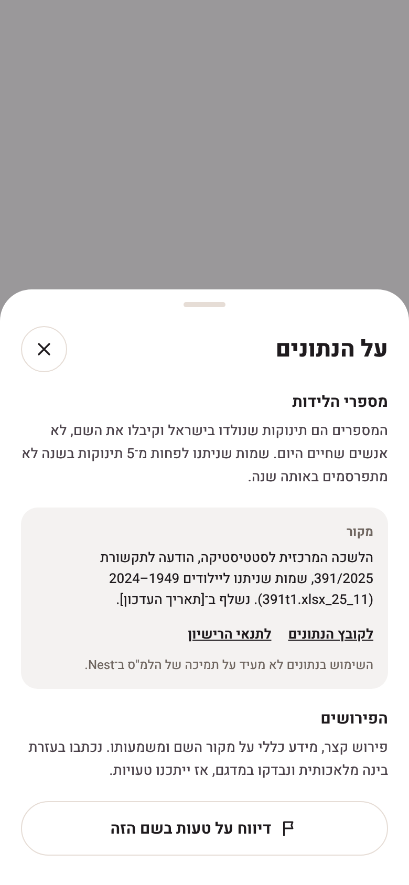 | 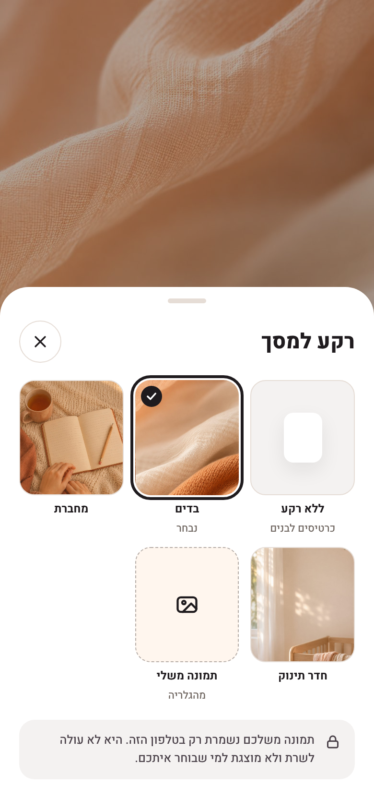 |

| 8 · בדים (default) | 9 · מחברת | 10 · חדר תינוק |
|---|---|---|
| 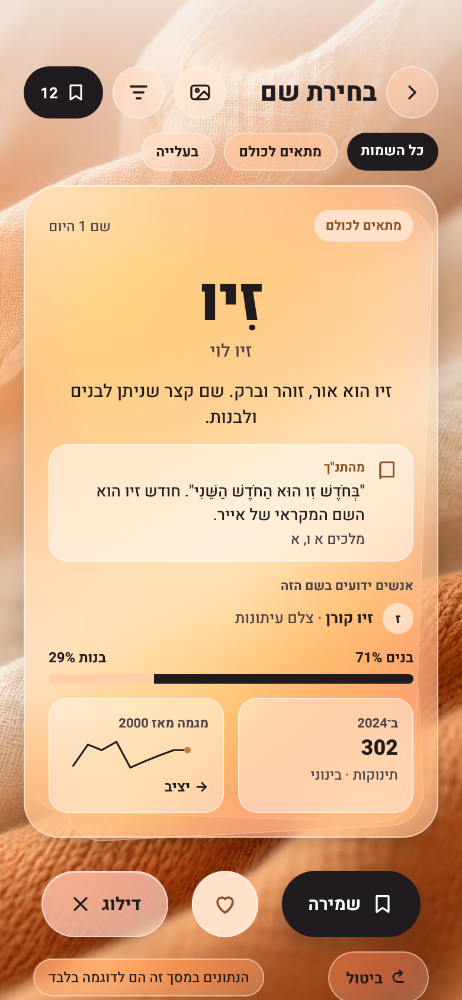 | 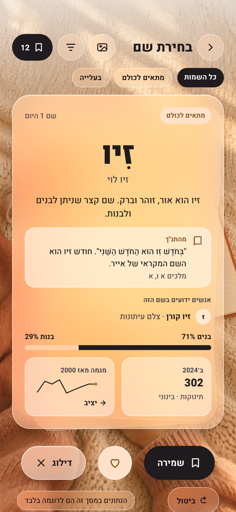 | 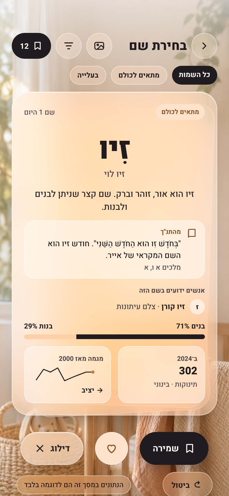 |

## 3. Functional requirements

### Entry points
- **FR-1** "עוד" tab → a row "בחירת שם" with a short subtitle ("שמות מכל הארץ, אחד אחרי השני").
- **FR-2** Today: one suggestion card from week 20 ("רוצים להתחיל לחשוב על שם?"), dismissible, shown once. Uses the existing suggestions mechanism (E06).

### First run
- **FR-3** A short intro: what the cards show, that the numbers are births from CBS, and that likes stay private. In a shared space: "כל אחד בוחר לבד. שם ששניכם שמרתם יופיע בהתאמות." Action: "התחלת בחירה".
- **FR-4** Optional surname field ("שם משפחה, לא חובה") so cards can show the full name. Stored per user on the device, never sent to the server.

### Look (design reviewed with the owner 2026-11-03)
- **Design system:** the Nest brand (ink, peach, clay, Heebo, liquid glass), the same one the app's `@/theme` uses now. Not the older pine-green Ken system.
- **Photo background + liquid glass:** the swipe screen sits on a full-bleed warm photo. The card, the cards stacked behind it, the round header buttons, the chips and the "דילוג" button are liquid glass (`GlassSurface`: blur, white tint, 1 px light border, `shadow.glassInset`). The photos are light, so text on glass stays ink, not white, with a soft light-to-clear scrim behind the header. Primary "שמירה" stays a solid ink pill and "אהבתי מאוד" a peach circle.
- **Backgrounds:** all three photos ship in `assets/images/names/` (`fabric.jpg`, the default; `notebook.jpg`; `nursery.jpg`), plus "ללא רקע" and the user's own photo (owner decision 2026-11-03, FR-8a to FR-8e).
- **Card stack:** two more cards peek out under the current one, slightly rotated (−3° and +2°), showing the next names on their bottom edge, so the screen reads as a deck. After a decision the stack advances.

### The card
- **FR-5** The name in large Heebo 800, the full name with surname below it if set, the sex tag, the intro line, a "מהתנ"ך" block when the name has one, "אנשים ידועים בשם הזה" with up to 2 people when it has any, the count line ("ניתן ל־{n} תינוקות ב־{year}" or the all-time line for names with no recent year), and a small trend chart (2000–2024) with the trend word next to it. Popularity and trend always carry a word, never only a color or shape.
- **FR-5a** Order inside the card (top to bottom): sex tag and "שם {n} היום"; the name with niqqud and the full name with surname; the intro; "מהתנ"ך" (verse or figure plus reference, on a peach-pale well with a book icon); "אנשים ידועים בשם הזה" (up to 2 rows, an initial avatar, the name in bold and one line on who they are); the boys/girls bar; the two number tiles (births in the latest year with the popularity band, and the trend chart with its word). Sections with no data are hidden, never shown empty.
- **FR-5b** Boys/girls bar: births by sex since 1949 from `m`/`f`. Labels "בנים {x}%" and "בנות {y}%" at its two ends, rounded to whole numbers, with "פחות מ־1%" and "מעל 99%" at the extremes instead of 0% and 100%. The boys part is `ink` and the girls part `peach`, never blue and pink. The bar is one accessibility element read as "מאז 1949 ניתן ל־{x} אחוז בנים ול־{y} אחוז בנות".
- **FR-6** Actions, as both gestures and buttons (44 × 44 or larger, Hebrew `accessibilityLabel`): "שמירה" (keep), "דילוג" (skip) and "אהבתי מאוד" (love, counts as keep and ranks first). The buttons are the primary path. Swipe toward the keep button = keep, so the gesture follows the layout in RTL instead of a fixed "right = yes".
- **FR-7** "ביטול" undoes the last decision (up to 10 back).
- **FR-8** Reduced motion: no fling animation, the next card fades in.

### Background
- **FR-8a** A "רקע" button in the swipe screen's header (icon + Hebrew `accessibilityLabel` "בחירת רקע") opens a bottom sheet "רקע למסך". It shows a row of 44 pt+ thumbnails: "ללא רקע", "בדים" (default), "מחברת", "חדר תינוק", and "תמונה משלי". The current choice is ringed in ink and marked with a check and the word "נבחר", not by color alone.
- **FR-8b** "ללא רקע": the plain `canvas` screen with one or two peach blobs, white cards with `shadow.card` instead of glass (the original board 2 look).
- **FR-8c** "תמונה משלי": picks one photo with `expo-image-picker` (library only, no camera, images only, crop to the screen's aspect). The photo is resized to about 1,200 px on its long side, saved in the app's document directory and **never uploaded**: it is a personal, per-device choice, and it isn't shared with the other members of the space. Replacing it deletes the old file. If the user denies photo access, the sheet says "אין גישה לתמונות. אפשר לאפשר גישה בהגדרות." with a link to the system settings.
- **FR-8d** Legibility on any photo: the bundled photos use the standard glass. A user photo gets a stronger glass (higher white tint) and a light scrim over the whole screen, so ink text keeps at least 4.5:1 on any image. If a luminance check of the image area under the card finds a very dark photo, the scrim is raised further rather than switching text to white.
- **FR-8e** The choice is stored per user on the device (AsyncStorage, like the filters). It applies to the swipe, intro and match screens. The default is "בדים". "Reduce transparency" in the OS accessibility settings forces solid white cards on any background.

### Which names come next
- **FR-9** (Full list, E16b; in E16 a shuffled deck of the 10 sample names.) A weighted random deck: about 50% common, 30% medium and 20% rare names, mixed, never repeating a name already decided. Seeded per user, so two partners don't see the same order.
- **FR-10** Filters ("סינון"): sex tag (בן · בת · מתאים לכולם · הכול), popularity, trend (בעלייה · יציב · בירידה), first letter, length (קצר: up to 3 letters, ארוך: 5 or more), and origin (by sector, labelled "נפוץ בקרב: יהודים · מוסלמים · נוצרים · דרוזים", default all). Filters persist per user.
- **FR-11** "לא להציג" list: names the user removed from every deck, editable.
- **FR-12** "הוספת שם" (works in E16, since it does not depend on the content file) lets the user type a name that is not in the data (rare names under the CBS threshold). It goes straight to the user's list with no count or intro.

### Lists
- **FR-13** Screen "השמות שלי" with segments:
  - "שמרתי": the user's kept names, loved ones first.
  - "התאמות" (only in a shared space with 2+ members): names that 2 or more members kept. A new match shows a calm one-time banner "יש התאמה: {name}" (ink, no green, no confetti). The partner's skips are never shown, and there is no "the other person didn't keep it" state.
  - "דו־קרב": two names from "שמרתי" (or from "התאמות" when it has 2+ names) side by side, pick one; repeats until a ranked top 5. Can be stopped and resumed. Available alone or together (each person runs their own).
- **FR-14** "על הנתונים" sheet: CBS attribution as required by the licence, that numbers are births 1949–2024 and names under 5 births a year are partly missing, that intros and Bible notes are general information written with AI help and may contain mistakes, and that known people come from Wikidata ("יש טעות? אפשר לדווח" opens a short report that goes to `client-log`).

## 4. Data & backend

- **Additive migration `0008_name_votes.sql`** (or the next free number):
  - `name_votes (space_id uuid, user_id uuid, name text, vote text check (vote in ('keep','love','skip','hidden')), custom boolean default false, updated_at timestamptz, primary key (space_id, user_id, name))`.
  - RLS: a member reads and writes **only their own rows** (`user_id = auth.uid()` and member of `space_id`).
  - `name_matches(p_space uuid)` — `security definer` function returning `(name, kept_by_count, loved_by_count, matched_at)` for names kept or loved by 2+ members of a space the caller belongs to. This is the only way anyone sees another member's choices, and it never returns skips.
  - Realtime on `name_votes` for the caller's own rows (multi-device), plus refetching `name_matches` on focus and every 60 seconds while the lists screen is open.
- Data layer: `useNameVotes`, `useNameMatches` in `src/data/`, persisted like the other queries; votes queue offline and sync on reconnect (E01 mechanism).
- Deploy follows the current backend process (see HANDOFF.md). The Supabase EU move should land first, so this migration is applied once, to the new project.
- Account deletion (E15) and leaving a space must delete the user's `name_votes`.

## 5. Edge cases

- Same name with different spellings (e.g. "נועה" vs "נעה") are different names in CBS data and stay separate.
- A member leaves the space → their votes stop counting toward matches.
- A space with 3+ members (a parent plus relatives): a match means 2 or more members kept it; the list shows "{n} שמרו".
- Duplicate custom name that also exists in the data → treat as the data name.
- A name kept, then skipped after undo → the latest vote wins.

## 6. Acceptance criteria

1. All 10 sample names show complete cards (intro, Bible block, people where listed, boys/girls bar, numbers), and the end-of-deck message appears after the 10th.
2. A user alone can swipe, filter, keep names, run "דו־קרב" to a top 5 and see "על הנתונים", with no sign-up of a partner anywhere in the flow.
3. Two members of a space keep the same name on different phones → both see it in "התאמות" within a minute. Neither can see the other's skips through the app or through the API (checked with a direct REST call as the other user).
4. Works fully offline for swiping; votes sync after reconnect.
5. VoiceOver/TalkBack: every card is read as "{name}, {sex tag}, {intro}, ניתן ל־{n} תינוקות ב־{year}, {trend}", and all actions are reachable without gestures.
6. CBS attribution matches the licence requirements.

## 7. Test plan

Unit: the background preference (default, persistence, falling back to "בדים" when the user photo file is missing), the boys/girls percentage labels (rounding, under 1% and over 99%), the deck holds exactly the names that have a content entry and never repeats one, the end-of-deck and empty-filter states, CSV parsing edge cases in `build-names.mjs` (quoted names like "ש""י"), sex tag, popularity band, trend, filter combinations. (The people filter, Bible reference check and deck weighting are tested in E16b.) Integration: RLS tests for `name_votes` and `name_matches` (own rows only, no skips leaked, non-members get nothing). Manual: each background (none, 3 photos, a dark and a busy user photo) with VoiceOver and Reduce Transparency; two devices in one space, one device alone, offline, VoiceOver and TalkBack, reduced motion.

## 8. Later: content for all names (E16b)

Not part of E16. Turns the 10-name sample into the full deck by generating `name-content.json` for about 2,500 names (every name given in 2024, 1,818, plus the most common all-time names), then the owner goes over it.

- **Intro:** generated by Claude with the rules in §2.
- **From the Bible:** generated by Claude, and every reference is checked mechanically against a Tanakh text source (for example Sefaria's open API) so the quoted words really appear in that verse. Entries that fail the check are dropped, not shown.
- **Known people (0–2):** taken from **Wikidata, never generated**, because invented people are the most harmful possible mistake here. Wikidata is CC0. Query: humans whose given name (P735) matches the Hebrew name, with a Hebrew Wikipedia article, ranked by number of Wikipedia sitelinks. Exclude politicians (occupation politician, or holding a political position), military commanders, and anyone flagged by the owner. The one-line `what` is drafted from the Hebrew Wikipedia lead and kept factual. Living people are named only by their public role.
- **Weighted deck (FR-9)** switches on once the full list is in.
- **QA:** the owner checks a random sample of 100 entries across all three parts. If more than 5 need changes, fix the prompt or query and check again. The report button (FR-14) catches the rest.
